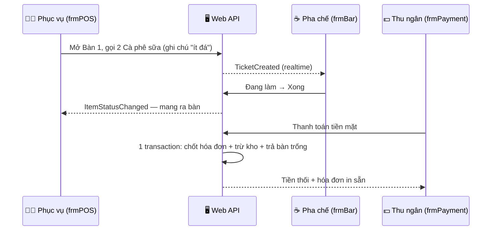
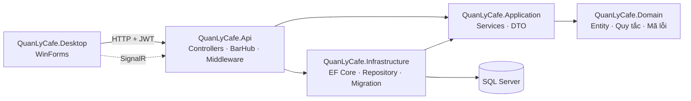

# ☕ QuanLyCafe — Quản lý quán cà phê, từ order đến hóa đơn

[](https://github.com/Duck2504/LapTrinhC-_QuanLyQuanCafe/actions/workflows/ci.yml)


> Phục vụ bấm gọi món — quầy bar thấy phiếu **ngay lập tức** — thu ngân tính tiền **một chạm** — kho **tự trừ** nguyên liệu theo công thức.
> Không giấy note, không gọi to, không lệch sổ cuối ngày.

QuanLyCafe là hệ thống quản lý quán cà phê gồm **ứng dụng WinForms** cho từng vị trí trong quán và **Web API** làm trung tâm dữ liệu. Mỗi nhân viên đăng nhập và chỉ thấy đúng phần việc của mình.

> 🚧 **Đồ án môn Lập trình C# — đang phát triển.** Xem [Tiến độ](#-tiến-độ) để biết phần nào đã chạy được.

---

## ✨ Vì sao chọn QuanLyCafe?

| | |
|---|---|
| ⚡ **Realtime giữa các quầy** | Order gửi đi là quầy bar nhận phiếu qua SignalR, không cần tải lại. Barista bấm *Xong* → phục vụ được báo ngay. |
| 🧾 **Kho tự trừ theo công thức (BOM)** | Mỗi món có định mức nguyên liệu. Thanh toán xong là kho trừ đúng 20g cà phê, 30ml sữa — không ai phải ghi tay. |
| 🔒 **Thanh toán an toàn** | Ghi hóa đơn + trừ kho + trả bàn nằm trong **một transaction**: lỗi ở bất kỳ bước nào là hoàn tác toàn bộ. Bấm thanh toán hai lần cũng không trừ kho hai lần. |
| 👥 **Phân quyền rõ ràng** | 4 vai trò **Quản lý · Thu ngân · Phục vụ · Pha chế**. Phục vụ gọi API thanh toán? Bị chặn (403). Tài khoản bị khóa? Bị đá ra ngay cả khi token còn hạn. |
| ⚠️ **Cảnh báo sắp hết hàng** | Nguyên liệu xuống dưới mức tối thiểu là Quản lý nhận cảnh báo tức thì. |
| 📊 **Báo cáo không lệch sổ** | Doanh thu theo ngày / tháng / ca, món bán chạy, tồn kho và hao hụt — tính từ chính các hóa đơn đã thanh toán. |

## 🧭 Một ca làm việc với QuanLyCafe



## 🖥️ Các màn hình

| Vai trò | Màn hình |
|---|---|
| Tất cả | Đăng nhập · Giao diện chính (menu theo vai trò) · Đổi mật khẩu |
| Phục vụ | Sơ đồ bàn + gọi món trên **một màn hình**, gộp / tách bàn |
| Pha chế | Danh sách phiếu theo thời gian, cập nhật realtime, báo hết nguyên liệu |
| Thu ngân | Thanh toán tiền mặt / ví điện tử / thẻ, tính tiền thối, in hóa đơn |
| Quản lý | Sản phẩm · Công thức (BOM) · Kho (nhập / xuất / kiểm kê) · Nhân viên & phân quyền · Báo cáo có biểu đồ |

> Thanh toán điện tử (Momo / VNPay / Thẻ) dùng **cổng giả lập** để demo các tình huống thành công, từ chối và quá thời gian — chưa kết nối cổng thật.

## 🏗️ Kiến trúc



- **Modular Monolith** chia theo 6 module: Nhân sự · Bán hàng · Danh mục · Kho · Thanh toán · Báo cáo.
- Desktop **chỉ** nói chuyện với API qua HTTP / SignalR — không chạm thẳng vào CSDL.
- Lỗi trả về dạng `ProblemDetails` có mã `ERR-*` (ví dụ `ERR-ORDER-002`: bàn đã có order mở) để Desktop hiện đúng thông báo tiếng Việt.
- Log có cấu trúc bằng Serilog (console + file theo ngày), không bao giờ ghi mật khẩu hay token.

**Công nghệ:** .NET 10 · ASP.NET Core Web API · EF Core (Code First, SQL Server) · SignalR · WinForms · JWT · Serilog · xUnit · GitHub Actions · Docker.

## 🐳 Chạy bằng Docker (nhanh nhất)

Chỉ cần cài [Docker Desktop](https://www.docker.com/products/docker-desktop/) (Windows/macOS) hoặc Docker Engine (Linux) — **không cần** .NET hay SQL Server. Docker dựng sẵn **API + SQL Server**, tự tạo bảng và tài khoản `manager` ở lần chạy đầu.

```bash
git clone https://github.com/Duck2504/LapTrinhC-_QuanLyQuanCafe.git
cd LapTrinhC-_QuanLyQuanCafe
cp .env.example .env        # Windows PowerShell: copy .env.example .env
```

Mở `.env`, đổi 3 mật khẩu (`SA_PASSWORD`, `JWT_KEY`, `MANAGER_PASSWORD`), rồi:

```bash
docker compose up -d --build
```

Đợi khoảng 1 phút cho SQL Server khởi động, sau đó mở `http://localhost:8080/health` → `{"status":"Healthy"}`. Đăng nhập bằng tài khoản `manager` với mật khẩu `MANAGER_PASSWORD`.

| Việc | Lệnh |
|---|---|
| Xem log API | `docker compose logs -f api` |
| Dừng (giữ dữ liệu) | `docker compose down` |
| Xóa sạch cả dữ liệu | `docker compose down -v` |
| Cập nhật code mới | `git pull` rồi `docker compose up -d --build` |

> Máy Mac chip Apple (M1/M2…): image SQL Server chỉ có bản x86 — bật *Use Rosetta* trong Docker Desktop.

## 🌐 Deploy lên Internet (VPS)

Thuê một VPS Linux bất kỳ (**tối thiểu 2 GB RAM** vì SQL Server), cài Docker, rồi làm y hệt mục trên. Desktop ở mọi nơi trỏ tới `http://<IP-của-VPS>:8080`.

**Có tên miền? Bật HTTPS miễn phí** (Let's Encrypt, tự gia hạn): trỏ DNS tên miền về IP VPS, đặt `DOMAIN=cafe.ten-mien.vn` trong `.env`, mở cổng 80/443 rồi chạy:

```bash
docker compose --profile https up -d --build
```

Desktop khi đó trỏ tới `https://cafe.ten-mien.vn`. Nên đóng cổng 8080 trên tường lửa để mọi truy cập đi qua HTTPS. SQL Server chỉ mở cho chính VPS (`127.0.0.1:1433`), không lộ ra Internet.

Mỗi lần push lên `main`, GitHub Actions cũng build sẵn image API tại `ghcr.io/duck2504/quanlycafe-api`, và có một job chạy thử toàn bộ `docker compose` để chắc bản Docker luôn chạy được.

## 🚀 Chạy từ mã nguồn (dành cho lập trình viên)

**Cần có:** .NET SDK 10, SQL Server (công cụ `dotnet-ef` chỉ cần khi tạo migration mới).

**1. Cấu hình bí mật** (lưu bằng user-secrets, không commit vào repo):

```bash
cd src/QuanLyCafe.Api
dotnet user-secrets set "ConnectionStrings:Default" "Server=localhost;Database=QuanLyCafe;Trusted_Connection=True;TrustServerCertificate=True"
dotnet user-secrets set "Jwt:Key" "<chuỗi ngẫu nhiên tối thiểu 32 ký tự>"
dotnet user-secrets set "Seed:ManagerPassword" "<mật khẩu tài khoản manager>"
cd ../..
```

**2. Chạy API** (tự tạo / cập nhật bảng khi khởi động):

```bash
dotnet run --project src/QuanLyCafe.Api
```

Lần chạy đầu tự tạo 4 vai trò và tài khoản `manager`. Kiểm tra: `GET http://localhost:5254/health` → `{"status":"Healthy"}`. Request mẫu có trong [`QuanLyCafe.Api.http`](src/QuanLyCafe.Api/QuanLyCafe.Api.http).

**3. Chạy ứng dụng Desktop** (Windows):

```bash
dotnet run --project src/QuanLyCafe.Desktop
```

**Chạy test:**

```bash
dotnet test QuanLyCafe.slnx
```

## 📈 Tiến độ

| Phần | Trạng thái |
|---|---|
| Solution 5 tầng, 9 bảng dữ liệu, migration, seed vai trò + Manager | ✅ Xong |
| Xử lý lỗi tập trung → ProblemDetails + mã `ERR-*` | ✅ Xong |
| Đăng nhập JWT, đổi mật khẩu, chặn tài khoản bị khóa, Serilog, `/health` | ✅ Xong |
| CI: build từng project, test, kiểm migration, Docker image lên GHCR | ✅ Xong |
| Docker Compose (API + SQL Server, HTTPS tùy chọn) để chạy và deploy VPS | ✅ Xong |
| Desktop: `ApiClient`, `SessionStore`, thông báo lỗi theo mã | ✅ Xong |
| Nhân viên & phân quyền, Danh mục sản phẩm, BOM | 🔨 Đang làm |
| Bàn & gọi món, quầy pha chế realtime (SignalR) | ⏳ Kế hoạch |
| Kho, thanh toán, in hóa đơn | ⏳ Kế hoạch |
| Báo cáo doanh thu có biểu đồ | ⏳ Kế hoạch |

## 👥 Nhóm phát triển

Nhóm 11 — môn Lập trình C#.

| Thành viên | Phụ trách |
|---|---|
| **Dư Gia Đức** | Nền tảng (Domain, CSDL, migration, xác thực), Nhân sự, Bán hàng, quầy pha chế realtime |
| **Phan Ngọc Thảo Nguyên** | Desktop shell, Danh mục & BOM, Kho, Thanh toán, Báo cáo |
