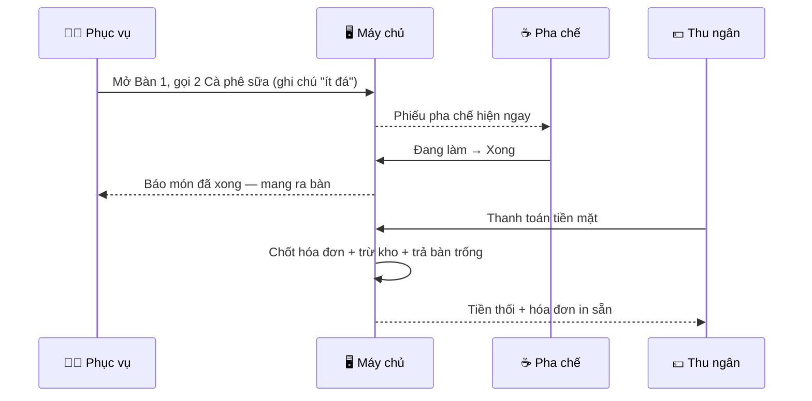

# ☕ QuanLyCafe — Quản lý quán cà phê, từ order đến hóa đơn

[](https://github.com/Duck2504/LapTrinhC-_QuanLyQuanCafe/actions/workflows/ci.yml)


> Phục vụ bấm gọi món — quầy bar thấy phiếu **ngay lập tức** — thu ngân tính tiền **một chạm** — kho **tự trừ** nguyên liệu theo công thức.
> Không giấy note, không gọi to, không lệch sổ cuối ngày.

QuanLyCafe là phần mềm quản lý quán cà phê gồm **ứng dụng Windows** cho từng vị trí trong quán và **máy chủ trung tâm** lưu toàn bộ dữ liệu. Mỗi nhân viên đăng nhập bằng tài khoản riêng và chỉ thấy đúng phần việc của mình.

---

## ✨ Tính năng nổi bật

| | |
|---|---|
| ⚡ **Realtime giữa các quầy** | Order gửi đi là quầy bar nhận phiếu ngay, không cần tải lại. Pha chế bấm *Xong* → phục vụ được báo để mang ra bàn. |
| 🪑 **Sơ đồ bàn trực quan** | Xem bàn trống / đang phục vụ, gọi món có ghi chú ("ít đá", "không đường"), gộp bàn và tách bàn. Hỗ trợ cả đơn mang đi. |
| 🧾 **Kho tự trừ theo công thức** | Mỗi món có định lượng nguyên liệu. Thanh toán xong là kho trừ đúng 20g cà phê, 30ml sữa — không ai phải ghi tay. Gọi món khi thiếu nguyên liệu sẽ bị báo ngay. |
| 💵 **Thanh toán nhanh, không sai** | Tiền mặt (tự tính tiền thối), ví điện tử, thẻ. In hóa đơn có xem trước. Bấm thanh toán hai lần cũng không bị trừ kho hai lần. |
| ⚠️ **Cảnh báo sắp hết hàng** | Nguyên liệu chạm mức tối thiểu là Quản lý nhận cảnh báo tức thì. Kiểm kê thiếu tự lập phiếu hao hụt. |
| 📊 **Báo cáo có biểu đồ** | Doanh thu theo ngày / tháng / ca, món bán chạy, tồn kho — tính từ chính các hóa đơn đã thanh toán. |
| 📱 **Web cho khách, gọi món qua QR** | Khách xem thực đơn theo danh mục, tìm món (gõ không dấu cũng được), xem chi tiết. Quét mã QR trên bàn để tự gọi món: quầy bar nhận phiếu ngay, khách theo dõi món *Chờ / Đang làm / Xong* trên điện thoại. |
| 👥 **Phân quyền rõ ràng** | 4 vai trò **Quản lý · Thu ngân · Phục vụ · Pha chế**. Tài khoản nghỉ việc bị khóa là không vào được nữa. |

## 🧭 Một ca làm việc



## 🖥️ Màn hình theo vai trò

| Vai trò | Dùng được |
|---|---|
| **Tất cả** | Đăng nhập · Màn hình chính (menu theo vai trò) · Đổi mật khẩu |
| **Phục vụ** | Sơ đồ bàn + gọi món trên một màn hình · Gộp / tách bàn · Bấm *Đã giao* |
| **Thu ngân** | Gọi món · Thanh toán · In hóa đơn |
| **Pha chế** | Danh sách phiếu theo thứ tự order · *Đang làm* / *Xong* / *Hết nguyên liệu* |
| **Quản lý** | Danh mục · Sản phẩm (ảnh, mô tả) · Định lượng (BOM) · Kho (nhập / xuất / kiểm kê) · Nhân viên · Báo cáo · Thanh toán · Xem quầy pha chế · In mã QR gọi món cho từng bàn |
| **Khách (Web)** | Trang chủ · Thực đơn theo danh mục · Tìm món · Chi tiết món · Gọi món tại bàn qua QR — không cần tài khoản |

---

## 💻 Yêu cầu hệ thống

| Thành phần | Cần có |
|---|---|
| Máy chạy ứng dụng (mỗi quầy) | Windows 10/11 |
| Máy chủ — **cách Docker** | Docker Desktop (Windows/macOS) hoặc Docker Engine (Linux), RAM từ 2 GB |
| Máy chủ — **cách cài trực tiếp** | Windows có .NET SDK 10 và SQL Server (bản Express miễn phí là đủ) |

Máy chủ và các máy quầy có thể là **cùng một máy** (quán nhỏ) hoặc các máy chung mạng LAN.

## 📦 Cài đặt

Có hai cách dựng máy chủ — chọn **một**. Sau đó cài ứng dụng cho các quầy ở [Bước 3](#bước-3--cài-ứng-dụng-cho-các-quầy).

### Bước 1 — Tải mã nguồn

```bash
git clone https://github.com/Duck2504/LapTrinhC-_QuanLyQuanCafe.git
cd LapTrinhC-_QuanLyQuanCafe
```

### Bước 2, cách A — Máy chủ bằng Docker (khuyên dùng)

Không cần cài .NET hay SQL Server. Docker dựng sẵn máy chủ + cơ sở dữ liệu, tự tạo bảng và tài khoản `manager` ở lần chạy đầu.

```bash
cp .env.example .env        # Windows PowerShell: copy .env.example .env
```

Mở file `.env`, **bắt buộc đổi** 3 giá trị: `SA_PASSWORD` (mật khẩu CSDL), `JWT_KEY` (chuỗi ngẫu nhiên ≥ 32 ký tự), `MANAGER_PASSWORD` (mật khẩu tài khoản quản lý). Rồi chạy:

```bash
docker compose up -d --build
```

Đợi khoảng 1 phút, mở `http://localhost:8080/health` — thấy `{"status":"Healthy"}` là xong. Địa chỉ máy chủ của bạn: **`http://<IP-máy-chủ>:8080/`**. Trang Web cho khách chạy cùng lúc ở **`http://<IP-máy-chủ>:5080/`**.

| Việc | Lệnh |
|---|---|
| Xem log | `docker compose logs -f api` |
| Dừng (giữ dữ liệu) | `docker compose down` |
| Cập nhật bản mới | `git pull` rồi `docker compose up -d --build` |
| Xóa sạch cả dữ liệu | `docker compose down -v` |

### Bước 2, cách B — Cài trực tiếp trên Windows

```bash
cd src/QuanLyCafe.Api
dotnet user-secrets set "ConnectionStrings:Default" "Server=localhost;Database=QuanLyCafe;Trusted_Connection=True;TrustServerCertificate=True"
dotnet user-secrets set "Jwt:Key" "<chuỗi ngẫu nhiên tối thiểu 32 ký tự>"
dotnet user-secrets set "Seed:ManagerPassword" "<mật khẩu tài khoản manager>"
cd ../..

dotnet dev-certs https --trust     # chỉ cần một lần
dotnet run --project src/QuanLyCafe.Api --launch-profile https
```

Máy chủ tự tạo bảng khi khởi động. Mở `https://localhost:7027/health` → `{"status":"Healthy"}`. Địa chỉ máy chủ của bạn: **`https://localhost:7027/`**.

Trang Web cho khách (cửa sổ dòng lệnh thứ hai), trỏ vào máy chủ vừa chạy:

```bash
dotnet run --project src/QuanLyCafe.Web -- --Api:BaseUrl=https://localhost:7027/
```

Mở `http://localhost:5080`. Mã QR từng bàn lấy trong Desktop: Quản lý → **QR gọi món** (trỏ tới `http://localhost:5080/Ban/<mã bàn>`, đổi địa chỉ ở hằng `WebBaseUrl` trong `src/QuanLyCafe.Desktop/Program.cs`).

> Dùng SQL Server Express? Đổi `Server=localhost` thành `Server=localhost\SQLEXPRESS`.

### Bước 3 — Cài ứng dụng cho các quầy

Mở [`src/QuanLyCafe.Desktop/Program.cs`](src/QuanLyCafe.Desktop/Program.cs), đặt `BaseUrl` thành địa chỉ máy chủ ở Bước 2 (mặc định là `https://localhost:7027/`):

```csharp
public const string BaseUrl = "http://192.168.1.10:8080/";
```

Đóng gói một lần, rồi chép thư mục `publish` sang mọi máy quầy và chạy `QuanLyCafe.Desktop.exe`:

```bash
dotnet publish src/QuanLyCafe.Desktop -c Release -r win-x64 --self-contained -o publish
```

> `--self-contained` giúp máy quầy **không cần cài .NET**.

---

## 🚀 Bắt đầu sử dụng

1. **Đăng nhập** bằng tài khoản `manager` và mật khẩu đã đặt ở Bước 2. Vào **Tài khoản → Đổi mật khẩu** ngay.
2. **Tạo nhân viên:** menu **Nhân viên** → thêm tài khoản cho Thu ngân, Phục vụ, Pha chế.
3. **Khai báo thực đơn:** **Sản phẩm** (tên, giá) → **Định lượng BOM** (mỗi món dùng bao nhiêu nguyên liệu) → **Kho** (nhập tồn đầu và mức tối thiểu).
4. Các quầy đăng nhập bằng tài khoản của mình là bắt đầu bán.

**Muốn xem thử với dữ liệu mẫu?** (10 bàn, 15 món, 12 nguyên liệu kèm định lượng — chạy lại không bị trùng):

```bash
# Cài trực tiếp
sqlcmd -S localhost -E -C -d QuanLyCafe -f 65001 -i scripts/seed-demo.sql
# Docker
sqlcmd -S localhost,1433 -U sa -P "<SA_PASSWORD>" -C -d QuanLyCafe -f 65001 -i scripts/seed-demo.sql
```

## ⚙️ Tùy chỉnh

| Cài đặt | Ý nghĩa | Mặc định |
|---|---|---|
| `Reporting:Shifts` | Giờ bắt đầu ca sáng / chiều / tối trong báo cáo | 06:00 · 12:00 · 18:00 |
| `Jwt:ExpiresHours` | Phiên đăng nhập kéo dài bao lâu | 8 giờ |
| `PaymentGateway:Mode` | Cổng thanh toán điện tử giả lập: `Success` · `Declined` · `Timeout` | `Success` |

Sửa trong `src/QuanLyCafe.Api/appsettings.json` (cài trực tiếp), hoặc thêm biến môi trường dạng `Reporting__Shifts__MorningStart=07:00` cho service `api` trong `docker-compose.yml` (Docker).

> Thanh toán ví điện tử / thẻ hiện dùng **cổng giả lập** để trình diễn các tình huống thành công, bị từ chối, quá thời gian — chưa kết nối Momo / VNPay thật.

## 💾 Sao lưu dữ liệu

```bash
# Cài trực tiếp
sqlcmd -S localhost -E -C -i scripts/backup.sql
# Docker — lệnh in ra đường dẫn file .bak, rồi lấy file ra máy:
sqlcmd -S localhost,1433 -U sa -P "<SA_PASSWORD>" -C -i scripts/backup.sql
docker compose cp db:<đường dẫn in ra> .
```

Nên đặt lịch chạy hằng ngày (Task Scheduler) và chép file sao lưu ra ổ khác.

## 🌐 Dùng qua Internet

Thuê VPS Linux (từ 2 GB RAM), cài Docker, làm theo **cách A**. Có tên miền thì bật HTTPS miễn phí (Let's Encrypt, tự gia hạn): trỏ DNS về IP VPS, đặt `DOMAIN=cafe.ten-mien.vn` trong `.env`, mở cổng 80/443:

```bash
docker compose --profile https up -d --build
```

Ứng dụng quầy khi đó dùng `BaseUrl = "https://cafe.ten-mien.vn/"`. Nên đóng cổng 8080 để mọi truy cập đi qua HTTPS — cổng 8080 là HTTP thường, chỉ hợp dùng trong mạng nội bộ.

## 🛠️ Gặp sự cố?

| Hiện tượng | Cách xử lý |
|---|---|
| Ứng dụng báo **"Không kết nối được máy chủ"** | Kiểm tra `BaseUrl` đúng địa chỉ máy chủ; mở `<địa chỉ>/health` trên máy quầy; mở cổng 8080 (hoặc 7027) trên tường lửa máy chủ. |
| Lỗi chứng chỉ khi dùng `https://localhost:7027` | Chạy `dotnet dev-certs https --trust` trên máy chủ. |
| `/health` chưa trả về ngay sau `docker compose up` | SQL Server cần khoảng 1 phút để khởi động lần đầu — đợi rồi thử lại. |
| Máy Mac chip Apple không chạy được SQL Server | Bật *Use Rosetta* trong Docker Desktop. |
| Quên mật khẩu nhân viên | Quản lý vào **Nhân viên** → đặt lại mật khẩu. |

---

## 🏗️ Công nghệ

.NET 10 · ASP.NET Core Web API · EF Core + SQL Server · SignalR (realtime) · WinForms · JWT · Serilog · ScottPlot · xUnit · Docker · GitHub Actions.

Ứng dụng quầy chỉ nói chuyện với máy chủ qua HTTP / SignalR, không chạm thẳng vào cơ sở dữ liệu. Lập trình viên chạy test bằng `dotnet test QuanLyCafe.slnx`.

## 👥 Nhóm phát triển

Nhóm 11 — môn Lập trình C#.

| Thành viên | Phụ trách |
|---|---|
| **Dư Gia Đức** | Nền tảng (CSDL, xác thực), Nhân sự, Bán hàng, quầy pha chế realtime |
| **Phan Ngọc Thảo Nguyên** | Ứng dụng Desktop, Danh mục & định lượng, Kho, Thanh toán, Báo cáo |
